# Примењени истраживачки рад — верзија 0.2

> **Статус:** технички и методолошки нацрт за менторски преглед; није за формалну предају
> **Датум циљане провере:** 23. октобар 2026.
> **Пресек кода:** `1f39d57315bb674b68d9fab7f07c411f1695a054` и радно стабло описано у [техничком baseline-у](research/technical-baseline-2026-09-23.md)
> **Имплементација:** локални offline хибрид и CLI постоје; јавни API и UI их не излажу
> **Емпиријски статус:** нема независних оцена релевантности, пилота, корисничких резултата ни закључка о H1–H3
> **Граница:** дугорочни најам у Србији је предмет рада, али синтетички улаз нема поље минималног трајања најма

> **Aktuelni prioritet:** довршити технички рукопис. Прикупљање података од
> тест корисника остаје отворено завршно питање; обим хипотеза за предају треба
> усагласити са ментором пре закључивања рада.

---

## Насловна страна

**АКАДЕМИЈА ТЕХНИЧКО-УМЕТНИЧКИХ СТРУКОВНИХ СТУДИЈА БЕОГРАД**  
**ОДСЕК ВИСОКА ШКОЛА ЕЛЕКТРОТЕХНИКЕ И РАЧУНАРСТВА СТРУКОВНИХ СТУДИЈА**  
**СТУДИЈСКИ ПРОГРАМ: РАЧУНАРСКО ИНЖЕЊЕРСТВО**

## ПРИМЕЊЕНИ ИСТРАЖИВАЧКИ РАД

# ПЛАТФОРМА ЗА ИЗДАВАЊЕ СМЕШТАЈА СА ПОДРШКОМ У ОДЛУЧИВАЊУ РЕАЛИЗОВАНА У ИНТЕГРИСАНИМ ТЕХНОЛОГИЈАМА

**Предмет:** Програмирање у интегрисаним технологијама 
**Студент:** Марко Ђокић 
**Број индекса:** 26/23 
**Предметни наставник:** Перица Штрбац 
**Ментор мастер рада:** Перица Штрбац 
**Организација:** Comtrade System Integration 
**Ментор у организацији:** [ДОПУНИТИ: ИМЕ, ЗВАЊЕ И ОСНОВ САРАДЊЕ]

Београд, септембар 2026.

Име ментора у организацији допуњује се када буде формално потврђено. Оно није
методолошки блокатор за израду верзије 0.2, али мора бити попуњено пре формалне
предаје ако га правила установе захтевају.

---

# Резиме

Рад испитује техничку изводљивост подршке тражиоцу при избору уже листе
смештаја за дугорочни најам у Србији. Постојећа платформа има претрагу и
правилима дефинисане препоруке. За локални оглед направљен је издвојени
евалуатор који на истим кандидатима пореди proxy редослед по свежини,
постојећу фиксну хеуристику без продукционог прикупљања кандидата и хибрид
тврдих филтера, експлицитних тежина и синтетичког понашајног профила.
Замрзнути скуп садржи 30 синтетичких огласа; два сценарија дају 16 и 13
кандидата. Листе се разликују, а локалне провере показују детерминистичан
прорачун у дефинисаном окружењу. Пошто независне оцене релевантности и
испитивање корисника нису спроведени, не може се закључити који редослед
боље одговара стварним потребама, нити потврдити хипотезе H1–H3. Дат је
протокол за касније вредновање, уз јасно одвајање постојећег система,
локалног огледа и могућег развоја у мастер раду.

**Кључне речи:** подршка одлучивању; издавање смештаја; вишекритеријумско
рангирање; препоручивање; offline евалуација; објашњивост.

# Садржај

1. Увод
2. Теоријске основе и сродна истраживања
3. Анализа постојећег система
4. Пројектовање унапређене подршке
5. Истраживачки материјал и методологија
6. Технички резултати
7. Планирана емпиријска евалуација
8. Анализа стручног доприноса
9. Ограничења и претње валидности
10. Закључак и даљи рад
11. Литература
12. Прилози

# 1. Увод

## 1.1. Предмет и практични проблем

Предмет рада је подршка тражиоцу при избору уже листе огласа за дугорочни
најам у Србији. Одлука је полуструктурисана: град, максимална цена и обавезна
погодност могу се изразити као правила, док су цена, локација, површина и
опремљеност међусобно супротстављени приоритети. DSS зато не замењује човека,
него повезује податке, модел и интеракцију како би избор био доследнији и
проверљивији.[^1][^2]

Платформа `IzdajIznajmiV2` обухвата огласе, претрагу, пријаве, обиласке,
комуникацију и трансакционе кораке. KYC, security, chat, Reverb и polling су
контекст интегрисаног система, али нису независне теме овог истраживања.
Испитује се искључиво редослед формално прихватљивих огласа за тражиоца. Одлука
издаваоца о кандидату није предмет рада и такав ranking није имплементиран.

## 1.2. Циљ и значај

Циљ је да се пројектује транспарентан хибрид тврдих филтера, експлицитних
приоритета и агрегираних сигнала понашања, а затим независно оцени у односу на
базни редослед и постојећу хеуристику. Допринос није тврдња да је формула
„објективно исправна“, већ репродуктиван начин да корисник зада компромис,
види разлоге и задржи коначну одлуку. Recommender системи морају се вредновати
и offline и кроз искуство корисника, јер сама prediction/ranking метрика не
описује употребљивост, разумљивост и поверење.[^10][^11][^12]

## 1.3. Истраживачка питања

**RQ1:** У којој мери унапређено рангирање повећава усклађеност корисничког
избора са задатим преференцијама у односу на базну претрагу?

**RQ2:** Како се предложени хибридни модел рангирања, на истом замрзнутом
скупу огласа, понаша у односу на постојећу хеуристику препорука?

**RQ3:** Како унапређена варијанта са рангирањем и објашњењем утиче на
ефикасност избора, перципирану употребљивост, разумљивост и поверење корисника?

## 1.4. Хипотезе и операционализација

**Општа хипотеза:** Транспарентно хибридно рангирање повећава усклађеност
избора смештаја са експлицитно задатим корисничким преференцијама.

* **H1 — квалитет рангирања:** предложени хибридни модел постиже бољу
  усклађеност са независно дефинисаном релевантношћу огласа од постојеће
  хеуристике и базног редоследа. Примарна мера је `nDCG@5`; допунске су
  `Precision@3` и top-1 ordinal relevance.[^22]
* **H2 — ефикасност одлуке:** корисници уз унапређену варијанту завршавају
  задатак са мање јединствено отворених огласа него уз базну претрагу. Време и
  успешност задатка су секундарне мере.
* **H3 — корисничко искуство:** унапређена варијанта са рангирањем, скором и
  објашњењем има повољније резултате употребљивости, разумљивости и поверења.
  Пореде се **комплетне варијанте** A и B; са две варијанте није могуће
  изоловати узрочни ефекат само текстуалног објашњења. SUS, разумљивост и
  поверење су различити конструкти и не сабирају се у једну скалу.[^11][^20]

## 1.5. Метод и организација

Рад спаја преглед литературе, audit кода на фиксираном commit-у, пројектовање,
offline ranking протокол и мало експлоративно within-subject истраживање са
10–20 пунолетних учесника. Верзија 0.2 спроводи технички offline део, али не
садржи независне оцене ни корисничке налазе. Наредна поглавља раздвајају
имплементирано, предложено и још неиспитано.

# 2. Теоријске основе и сродна истраживања

## 2.1. DSS и вишекритеријумско одлучивање

Рад Gorry-а и Scott Morton-а и књига Keen-а и Scott Morton-а представљају
ране изворе о системима за подршку одлучивању.[^1][^2] Избор смештаја овде
посматрамо као делимично структуриран задатак: део захтева је дискретан,
а део зависи од личног односа између критеријума. Ова класификација је
ауторско полазиште, не емпиријски налаз тих извора.

AHP изводи приоритете из парних поређења.[^3] Hwang и Yoon систематизују
методе вишекритеријумског одлучивања,[^4] а Triantaphyllou их теоријски и
емпиријски пореди.[^5] Избор начина нормализације и агрегирања зато треба
документовати као пројектну одлуку. За кратак web задатак
предлаже се лакше објашњива пондерисана сума, али тек после некомпензаторних
филтера. Цена испод буџета не сме надокнадити одсуство обавезног интернета.

## 2.2. Recommender системи и хибридизација

Content-based, collaborative и хибридни приступи користе различите доказе о
релевантности и имају различите cold-start и sparsity проблеме.[^6] Burke-ова
таксономија показује да „хибридно“ означава начин комбиновања компоненти, не
нужно machine learning.[^7][^8] Савремени приручник додатно разликује циљеве,
контекст и evaluation слојеве.[^9]

Предлог овог рада је rule-based хибрид: експлицитне тежине имају примат, а
понашајни профил их умерено прилагођава. Нема training скупа, fit поступка,
научених параметара ни тврдње о ML моделу. Ова граница је важна јер постојећа
Laravel имплементација такође примењује фиксне поене на град, цену, собе,
површину, погодности, свежину и извор кандидата.

## 2.3. Објашњивост, поверење и UX

Објашњења могу служити транспарентности, исправљању, ефикасности, поверењу и
прихватању, али оптимизација уверљивости није исто што и верно објашњење.[^13]
Рани преглед пописује објашњења у препоручивању,[^14] а експеримент Herlocker-а
и сарадника пореди различите приказе исте MovieLens препоруке и бележи
различито прихватање.[^15] Bilgic и Mooney посебно раздвајају
задовољство од промотивног ефекта.[^16] Зато разлог у предложеном систему мора
проистећи из стварно коришћеног доприноса, без маркетиншког накнадног текста.

Knijnenburg-ов модел UX-а раздваја објективне и субјективне конструкте.[^11]
Pu и сарадници објавили су засебан оквир усредсређен на корисника, али његов
садржај у овој провери није био доступан.[^12] H3 стога одвојено анализира
SUS, појединачне ставке разумљивости и појединачне ставке поверења.

## 2.4. Избор некретнине и смештаја

Примена AHP-а на избор куће коју описују Ball и Srinivasan показује природну вишекритеријумску
структуру домена.[^17] Рад Opoku-а и Abdul-Muhmin-а описује разлике у стамбеним атрибутима код
испитаника са нижим примањима у Саудијској Арабији; Sirgy и сарадници
указују на симболичке, поред функционалних, аспекте избора дома. Ове
налазе не преносимо непосредно на дугорочни најам у Србији.[^18][^19] Скор зато није гаранција квалитета некретнине: служи
само за ужу листу пре провере, разговора и обиласка.

## 2.5. Евалуација

Zangerle и Bauer систематизују offline, online и user-study перспективе,[^10]
а Shani и Gunawardana показују да избор метрике зависи од задатка.[^23]
`nDCG` подржава степеновану релевантност и већу тежину ставки при врху листе;
у овом раду служи као планирана мера, не као израчунат резултат.[^10][^22]
SUS је десетоставни инструмент чији трансформисани резултат 0–100 није
проценат; његова емпиријска употреба захтева опрезно тумачење.[^20][^21]
Са 10–20 учесника inferential power је ограничен, па су дескриптивни приказ и
величина ефекта важнији од бинарног читања `p` вредности.[^24]

## 2.6. Интегрисане технологије као носилац експеримента

Vue SPA, Laravel API, PostgreSQL, Meilisearch, Sanctum, queue и Reverb нису
теоријски допринос сами по себи. Њихова улога је да обезбеде исти dataset,
контролисан API уговор, ауторизацију, logging и поновљив приказ варијанти.
Техничке тврдње су везане за code evidence, не за генеричке описе технологија.

# 3. Анализа проблема и постојећег система

## 3.1. Актери, критеријуми и захтеви

Гост може да претражује јавне огласе; аутентификовани `seeker` чува претраге,
добија препоруке и подноси `Application`; `landlord` управља огласом и
пријавама. Активни ток је `Application`, док `BookingRequest` нема активне API
руте. Истраживачка граница обухвата само seeker одлуку.

Тврди услови су активан статус, сценаријски град/зона, максимум цене и
обавезна погодност. Меки критеријуми су цена унутар опсега, локацијска
погодност, површина, собе, опремљеност и, само ако dataset то оправда,
оцена/број оцена и свежина. Систем мора бити детерминистичан, објашњив,
проверљив над замрзнутим подацима и без откривања понашања тражиоца издаваоцу.

## 3.2. Постојећа претрага

Канонски уговор је `/api/v1`. `GET /api/v1/listings` примењује SQL филтере и
Haversine radius за map mode. Search V2 преко `/api/v1/search/listings` може
користити Meilisearch само када то одреде backend driver и frontend
`VITE_SEARCH_V2`; map/radius остаје SQL. `/map` је showcase, док `Search.vue`
садржи стварни Leaflet ток. Favorити су у browser кључу `ii-favorites`; real
API нема favorites endpoint.

## 3.3. Постојећа хеуристика препорука

`GET /api/v1/recommendations` је у Sanctum/session/MFA групи, а controller
дозвољава `seeker` и `admin`, одбија `landlord`. `RecommendationService`
формира кандидате из до 20 прегледа, 10 saved searches, пет search snapshots,
сличних огласа и свежих огласа у преферираном граду. Ако нема сигнала, fallback
враћа активне огласе по свежини. Кандидати се бодују фиксним поенима, максимум
је 30 резултата, cache траје седам минута, а `why` садржи највише три разлога.

То је објашњива rule-based хеуристика, не тренирани ML модел. Корисник не задаје
експлицитне тежине, API не враћа допринос сваког критеријума, а једнаки скорови
немају јавно спецификован стабилан секундарни кључ. Ове чињенице су audit-оване
у [матрици доказа](research/evidence-matrix.md).

## 3.4. Потврђена ограничења платформе

Real upload слика постоји и не третира се као placeholder. Reverb постоји, али
chat и notifications задржавају polling fallback. Production-like Compose са
тестним подацима није доказ стварне пословне продукције. Candidate ranking за
издаваоца и предложени preference-weight API нису пронађени. Ова ограничења
спречавају да планиране могућности буду представљене као резултат.

# 4. Пројектовање унапређене подршке у одлучивању

## 4.1. Архитектура и ток података

Слика 1 раздваја постојећи јавни ток од локалне CLI провере и од предложене
корисничке варијанте. За разлику од јавног `RecommendationService`, локални
евалуатор не чита продукциону базу и није позван из руте.

**Слика 1. Архитектура постојећег система и локалног огледа.** Извор:
ауторски дијаграм према `frontend/src/services/realApi.ts`,
`backend/routes/api.php`, `backend/app/Http/Controllers/RecommendationsController.php`,
`backend/app/Services/RecommendationService.php`,
`backend/app/Services/LegacyRecommendationScorer.php` и
`backend/app/Services/PirOfflineEvaluator.php`, пресек кода
`1f39d57315bb674b68d9fab7f07c411f1695a054`, провера 23. 10. 2026.
Уређив [извор](diagrams/arhitektura.mmd).

Локални offline ток учитава замрзнути JSON и manifest, проверава SHA-256 пре
израчунавања и примењује сценаријске hard filters једном. Исти кандидатни скуп
улази у базни proxy, издвојену фиксну хеуристику и хибрид. JSON резултат чува
верзије, параметре, потпуне rank листе, доприносе и највише три идентификатора
критеријума као разлоге; временска поља су издвојена у `run_metadata`.
Идентификатори још нису кориснички текст. Продукциони API не позива хибрид.
Слика 2 приказује да се три листе добијају из истог скупа после тврдих
филтера; предлог независног оцењивања је засебан следећи корак.

**Слика 2. Ток замрзнутих података у локалном поређењу.** Извор: ауторски
дијаграм према `backend/app/Console/Commands/PirOfflineEvaluateCommand.php`,
`backend/app/Services/PirOfflineEvaluator.php`, `research/dataset-v1.json`,
`research/scenarios-v1.json`, `research/manifest-v1.json` и
`research/offline-evaluation-v1.json`, пресек кода
`1f39d57315bb674b68d9fab7f07c411f1695a054`, провера 23. 10. 2026.
Уређив [извор](diagrams/tok-podataka.mmd).

**Табела 1. Разграничење стања (извор: аутор, изведено из кода на наведеном commit-у).**

| Слој | Имплементирано | Предложено | Неиспитано |
|---|---|---|---|
| претрага | SQL/Meili филтери; offline hard-filter snapshot | корисничка B варијанта | pilot тежина сценарија |
| препоруке | фиксна хеуристика + cache; локални offline хибрид | уношење експлицитних тежина у B | релевантност на независним оценама |
| приказ | до три `why` разлога у API-ју; offline скор и criterion contributions | кориснички текст разлога и B UI | UX ефекат варијанте B |

## 4.2. Филтрирање, тежине и скор

Нека је (A) скуп огласа, а (H_j) тврди услов. Скуп кандидата је:

$$
A' = \{a \in A \mid H_j(a)=1,\; j=1,\ldots,m\}.
$$

Експлицитне нормализоване тежине су (e_i), понашајне (b_i), а закључани
коефицијент мешања (λ) мора бити изабран пре offline поређења:

$$
w_i=(1-\lambda)e_i+\lambda b_i, \qquad \sum_i w_i=1.
$$

За нормализовану корисност (x_i(a)\in[0,1]):

$$
S(a)=100\sum_i w_i x_i(a).
$$

Већи (λ) не сме прикривено надјачати изричиту намеру. Примарна вредност је
закључана 23. септембра 2026, пре offline поређења, на `λ=0,25`: 75% тежине остаје непосредно
задатој намери, а 25% понашајном профилу. Sensitivity анализа на `λ∈{0; 0,25;
0,50}` проверава робусност, али се H1 оцењује на примарној вредности и она се
не бира накнадно према relevance оценама. Pilot може открити неразумљивост
контроле, али не сме оптимизовати λ према коначном исходу.

## 4.3. Missing-data, објашњења и tie-break

Missing није нула. Обавезно непознато поље искључује кандидат или означава
dataset грешку; код меког критеријума тежина се прерасподељује само преко
доступних критеријума и приказује упозорење. Оцена без `ratings_count` се не
користи. Разлог се генерише из стварног (w_i x_i(a)), не из rank позиције.

Редослед је: `S DESC`, затим мање missing поља, затим `listing_code ASC`.
Свежина није скривени tie-break ако није сценаријски критеријум. Идентичан
улаз, dataset и верзија модела морају дати идентичан output.

## 4.4. Локални истраживачки adapter

Верзија 0.2 користи `PirOfflineEvaluator` и локалну команду `pir:evaluate` са
експлицитним путањама за dataset, сценарије, manifest и излаз. Она не уписује
базу и нема нову јавну руту. Валидација одбија негативне и ненумеричке
тежине, непознат критеријум, невалидну суму и `λ` ван `[0,1]`. Издвојени
`LegacyRecommendationScorer` се користи и у постојећем API сервису и у
score-only контроли. За корисничку варијанту B потребан је посебан будући
уговор, текст разлога и изоловано окружење; `GET /api/v1/recommendations`
сада нема улаз за експлицитне тежине.

## 4.5. Ток обраде и граница интеграције

На слици 3 је поступак локалног рангирања: после заједничких тврдих
филтера три гране користе различите кључеве, а хибрид чува доприносе
критеријума. Пунктир означава тек предложено корисничко вредновање.

**Слика 3. Поступак локалног рангирања.** Извор: ауторски дијаграм према
`backend/app/Services/PirOfflineEvaluator.php`,
`backend/app/Services/LegacyRecommendationScorer.php`,
`backend/tests/Unit/PirOfflineEvaluatorTest.php` и
`research/offline-evaluation-v1.json`, пресек кода
`1f39d57315bb674b68d9fab7f07c411f1695a054`, провера 23. 10. 2026.
Уређив [извор](diagrams/postupak-rangiranja.mmd).

Улаз експеримента чине три одвојене целине: синтетички огласи, сценарији са
правилима и тежинама, те manifest са контролним збировима. Провера интегритета
претходи сваком прорачуну. За сваки сценарио прво се једном издвоји скуп
кандидата према статусу, граду, буџету и обавезним погодностима. Тек потом се
исти огласи прослеђују трима поступцима рангирања. Тако поређење редоследа
не меша ефекат модела са разликом у прикупљању кандидата.

Поступак има следећи низ корака: (1) учитавање и провера верзија и SHA-256,
(2) провера структуре и дозвољених вредности, (3) примена тврдих услова,
(4) израчунавање базног редоследа, фиксне хеуристике и хибрида,
(5) стабилно сортирање и (6) упис потпуних листа, параметара и доприноса
критеријума. Излаз бележи и недостајућа мека поља; време извршења је одвојено
од садржаја листа како се поновљивост може проверити независно од тренутка
покретања.

Овај ток је експериментални слој, а не нови кориснички ток платформе.
Постојећи јавни endpoint прикупља кандидате и бодује их по сопственим
правилима; offline контрола преузима само фиксни scorer. Зато се резултат
поређења односи на рангирање *истих* кандидата, не на квалитет целе
продукционе претраге и препорука. За будућу интеграцију у мастер раду били би
потребни кориснички унос тежина, API уговор за те тежине, приказ читљивих
разлога и засебна провера целог тока.

# 5. Истраживачки материјал и методологија

## 5.1. Замрзнути dataset и сценарији

Замрзнути [`dataset-v1.json`](research/dataset-v1.json) садржи 30 ауторски
генерисаних синтетичких огласа, без личних података и слика. Порекло,
`data_status`, `missing_fields`, верзије и SHA-256 су експлицитни у
[`manifest-v1.json`](research/manifest-v1.json). Валидатор и аутоматски тестови
проверавају schema, јединствене кодове, дозвољене вредности и checksum.
Овај скуп није узорак стварног тржишта.

S1 описује запослену особу којој су цена и локација најважније, уз гаражу као
пожељну погодност. S2 описује студентски/дељени најам са обавезним интернетом
и trade-off-ом површине, опремљености и цене. Просторни оквир dataset-а је
закључан на **Београд, Ниш и Нови Сад**. Конкретан град сценарија, зоне и
буџети и тежине су закључани у [`scenarios-v1.json`](research/scenarios-v1.json)
пре независних оцена. S1 оставља 16, а S2 13 кандидата; тест проверава да
постоје супротстављене предности и да ниједан кандидат није најбољи по свих
пет меких критеријума. Евалуатор одбија улаз без тог услова. Разумљивост
задатака још треба проверити пилотом.
Пуна schema је у
[спецификацији сценарија](research/scenarios.md).

## 5.2. Независна relevance методологија

Нови алгоритам неће бити вреднован oracle функцијом једнаком његовој формули,
јер би то било кружно вредновање. Најмање два оцењивача, слепа за алгоритам и
редослед, додељују сваком огласу по сценарију ordinal relevance `0–3` из
закључаног rubric-а: `0` крши hard filter или је практично неупотребљив; `1`
испуњава hard filters, али има велики сценаријски недостатак; `2` представља
разуман компромис; `3` веома добро испуњава приоритете без критичног
недостатка. Rubric садржи сидрене примере, али не алгоритамске скорове. Чувају
се почетне оцене и неслагања; свако неслагање решава се документованом
дискусијом до консензуса. Ако га нема, трећи слепи оцењивач даје независну
оцену, а коначна је медијана три целобројне оцене. Правило је закључано
23. септембра 2026, пре оцењивања. Оцењивање још није спроведено.

Тек над adjudicated оценама рачунају се `nDCG@5`, `Precision@3` и top-1
relevance. За `Precision@3` релевантан је оглас са adjudicated оценом `≥2`, а
именилац је три; сваки сценарио зато мора имати најмање три валидна кандидата.
Одвојени engineering тестови проверавају hard filters,
детерминистичност, стабилност, monotonicity, missing-data и latency.

## 5.3. Offline техничка евалуација

Три редоследа користе исти филтрирани скуп. Базни `published_at DESC` је
offline proxy за `created_at DESC` претрагу, а постојећа хеуристика је
score-only контрола без продукционог прикупљања кандидата и source бонуса.
Хибрид користи пет критеријума и примарно `λ=0,25`; `0` и `0,50` су одвојени
резултати анализе осетљивости. Потпуне листе и checksum-и су у
[машински читљивом излазу](research/offline-evaluation-v1.json) и
[логу](research/offline-evaluation-log-2026-09-23.md). Пошто нема независних
оцена, `nDCG@5`, `Precision@3`, top-1 relevance и макро просек нису рачунати.
Cache, latency и продукционо прикупљање кандидата нису мерени у овом току.

## 5.4. Корисничка евалуација

Exploratory within-subject узорак има 10–20 пунолетних учесника. Позив се
објављује на доступним online forum платформама, учешће је добровољно, а из
скупа пријављених који испуњавају критеријуме врши се случајан избор помоћу
забележеног random seed-а. То је случајан избор из self-selected оквира
добровољаца, а не репрезентативан случајан узорак становништва Србије. Сваки
изабрани учесник користи
A — базну претрагу без preference rankinga — и B — целу унапређену варијанту
са хибридним ranking-ом и објашњењем. Контрабаланс су четири секвенце:
`A/S1 → B/S2`, `A/S2 → B/S1`, `B/S1 → A/S2`, `B/S2 → A/S1`.

Пилот проверава разумљивост, једнаку тежину сценарија, број кандидата, трајање,
контроле тежина, logging и превод SUS-а. За SUS се предлаже forward превод,
независан back-translation, поређење са изворним значењем и cognitive pilot;
редослед, поларитет и стандардна формула бодовања не мењају се. Примарне мере
су независна relevance
изабраног огласа и број јединствено отворених огласа. Секундарне су време,
успешност, SUS, појединачне оцене разумљивости, појединачне оцене поверења и
отворени коментар. Инструмент је у [прилогу](research/instruments.md).

## 5.5. План анализе

За сваку варијанту приказују се број валидних парова, медијана, IQR, минимум и
максимум, као и paired difference сваког учесника. Exploratory paired тест и
effect size могу се додати уз интервал неизвесности, али `p` вредност није
главни доказ. Missing/withdrawn парови се не импутирају без унапред одобреног
правила. SUS 0–100 се не назива процентом; Likert ставке се не спајају без
провере конструкта.

## 5.6. Етика и приватност

Прикупља се минимум података под pseudonymous шифром. Информисани пристанак,
могућност одустајања и повлачење до анонимизације морају бити јасни. Контакт и
резултати чувају се одвојено. Предлаже се retention до 12 месеци после одбране,
затим брисање идентификационог кључа и raw података или неповратна
анонимизација; коначни рок морају одобрити ментор и организација. Снимање
екрана и/или звука је дозвољено само уз посебну, опциону сагласност; одбијање
снимања не искључује учесника из основног теста.

У јавни GitHub смеју само анонимизовани агрегати, dataset без PII, сценарији,
непопуњени инструменти, analysis скрипта и репродуктивни технички резултати.
Raw одговори, снимци и потписане сагласности не смеју бити објављени.

# 6. Технички резултати верзије 0.2

Историјски покушај из 0.1, када Laravel зависности нису биле доступне, остаје
у [baseline-у верзије 0.1](research/technical-baseline.md). За овај пресек
извршени су локална offline команда, циљане провере и пуни backend suite са
привремено учитаним `pdo_sqlite`. Коришћен је синтетички улаз; тржишни подаци,
продукциона база и јавна рута препорука нису мењани.

**Табела 2. Поновљивост и провере.** Извор: аутор; команде и ограничења у
`research/technical-baseline-2026-09-23.md`.

| Провера | Добијени резултат | Граница |
| --- | --- | --- |
| Замрзнути улаз | 30 синтетичких огласа; manifest проверава SHA-256 | нема тржишне репрезентативности |
| Тврди филтери | S1: 16; S2: 13; нула прекршаја у ручној провери | трајање најма није поље улаза |
| Три потпуне rank листе | базни proxy, score-only контрола и хибрид имају исте кодове | редослед сам по себи није оцена релевантности |
| Два покретања | исти садржај осим `run_metadata` | време извршавања није performance benchmark |
| Циљани PIR/API тестови | 23 passed, 564 assertions | SQLite тест окружење |
| Пуни backend suite | 164 passed, 1132 assertions | без PostgreSQL/Meilisearch e2e провере |
| `./vendor/bin/pint --test` | пролаз, 388 фајлова | стилска провера |

Бројеви 23/564, 164/1132 и 388 у табели су **историјски baseline од
23. 10. 2026.**, забележен уз пресек кода `1f39d57315bb674b68d9fab7f07c411f1695a054`
и тадашње радно стабло; нису поново мерени при овом прелому. Нова циљана
провера на commit-у `abe0d9e468225bff9bcfe7041cc27c34410c7979` са
текућим изменама, командом из `backend/`
`php artisan test --filter='(PirOfflineEvaluatorTest|PirOfflineEvaluateCommandTest)'`,
дала је **11 passed, 524 assertions** 23. 10. 2026. Она проверава локални
евалуатор и CLI, али не укључује API, базу ни јавни UI.

За S1 првих пет кодова су: базни `001, 002, 003, 004, 005`, хеуристика
`007, 010, 004, 011, 005`, хибрид `004, 007, 010, 001, 002`. За S2 су:
базни `002, 003, 004, 006, 007`, хеуристика `007, 010, 011, 004, 006`,
хибрид `004, 007, 016, 010, 011`. Сви кодови имају префикс `PIR-`.
Разлика у редоследу показује да компаратори нису идентични, али без независних
оцена нема доказа да је један релевантнији. Овај резултат зато не потврђује H1.

## 6.1. Поређење три редоследа по сценарију

**Табела 3. Позиције одабраних кандидата.** Извор: ауторски прорачун из
`research/offline-evaluation-v1.json`, проверен према
`PirOfflineEvaluator::evaluate` и
`research/offline-evaluation-log-2026-09-23.md`.

| Сценарио | Оглас | Proxy свежине | Фиксна хеуристика | Хибрид, λ=0,25 |
| --- | --- | ---: | ---: | ---: |
| S1 | `PIR-001` | 1 | 15 | 4 |
| S1 | `PIR-004` | 4 | 3 | 1 |
| S1 | `PIR-007` | 7 | 1 | 2 |
| S1 | `PIR-010` | 10 | 2 | 3 |
| S2 | `PIR-002` | 1 | 13 | 6 |
| S2 | `PIR-004` | 3 | 4 | 1 |
| S2 | `PIR-007` | 5 | 1 | 2 |
| S2 | `PIR-016` | 12 | 6 | 3 |

У S1 proxy ставља `PIR-001` и `PIR-002` на врх јер су најновији по
`published_at`; фиксна хеуристика их спушта на 15. и 16. место, док
хибрид додељује 4. и 5. место. Фиксна хеуристика даје по 85 поена
огласима `PIR-007` и `PIR-010`; секундарни кључ `listing_code ASC`
поставља `007` испред `010`. Хибрид даје `PIR-004` скор `84,209596`,
испред `007` са `81,452020` и `010` са `78,694444`. Ова промена следи
из сценаријских тежина и нормализованих корисности, а не из независно
утврђеног квалитета смештаја.

У S2 proxy ставља `PIR-002` на прво место, али га фиксна хеуристика
ставља на последње, 13. место; хибрид га смешта на 6. место. Три огласа
`PIR-007`, `PIR-010` и `PIR-011` имају по 80 хеуристичких поена, па
редослед међу њима опет зависи од кода. Хибрид поставља `PIR-004` на
прво место са `81,163889`, затим `007` са `80,816667`, а `PIR-016`
подиже са 12. proxy и 6. хеуристичког на 3. место са `71,747222`.
Разлика између `PIR-016` и четвртог `PIR-010` износи само `0,055555`
поена у приказаном скору, што показује да позицију треба читати уз скор.

Базни редослед је **proxy**, не снимак јавне претраге: локални
`published_at DESC` приближава `created_at DESC`, а није исто поље нити
мери стварни search backend. Score-only контрола позива исти
`LegacyRecommendationScorer` као постојећи API, али прима замрзнути
сценаријски профил и датум `as_of`; не извршава продукционо прикупљање
кандидата, не додељује `source` бонусе и нема cache. Зато позиције из
табеле нису очекивани јавни `GET /api/v1/recommendations` одговор.
Хибрид је локални адаптер: пет тежина и `λ=0,25` задају скор,
недостајући меки атрибут прерасподељује тежине на доступне, а редослед
разрешава незаокруженим скором, бројем недостајућих атрибута и кодом.

Контроле показују да се на истих 16 и 13 кандидата могу поновљиво
израчунати три потпуне листе. Manifest проверава SHA-256 улаза; два
историјска покретања дала су једнак JSON ван `run_metadata`. Тестови
евалуатора проверавају валидацију, паритет за фиксни scorer, гране
формуле, изједначења и недостајуће податке. То је проверљив технички
допринос: изолација поређења и траг доприноса сваког критеријума.
Провере не доказују репрезентативност синтетичких огласа, релевантност
редоследа, рад PostgreSQL/Meilisearch тока, брзину јавног API-ја нити
корисничко разумевање разлога. Осетљивост на `λ=0` и `λ=0,50` мења
појединачне позиције, нарочито прва два места у S2 при `λ=0,50`, али
без независних оцена није мера побољшања. H1 остаје непроверена.

## 6.2. Пример прорачуна и тумачење разлике

За сценарио S1 експлицитна тежина цене је `0,35`, а тежина из понашајног
профила `0,25`. Са закључаним `λ=0,25`, коначна тежина цене је
`0,75 × 0,35 + 0,25 × 0,25 = 0,325`. Истим правилом добијају се тежине
зоне `0,2875`, површине `0,1625`, броја соба `0,10` и погодности `0,125`.
Њихов збир је један. Ово је унапред одређен компромис између непосредно
задатих приоритета и понашајног профила, а не вредност научена из избора
учесника.

Прворангирани оглас `PIR-004` у хибридном редоследу S1 има укупан скор
`84,209596`. Његови доприноси у поенима су: зона `28,75`, цена `22,027778`,
погодности `12,5`, површина `10,931818` и собе `10`. Збир заокружених
доприноса даје приказани укупан скор, уз заокруживање на шест децимала.
Идентификатори три највећа доприноса (`zone`, `price`, `facilities`) сачувани
су као разлози; они још нису текст објашњења проверен са корисницима.
Потпуни подаци и рангирања су у [излазу експеримента](research/offline-evaluation-v1.json).

Исти оглас је четврти у базном редоследу и трећи према фиксној хеуристици.
То показује како изабрани критеријуми мењају приоритет једног кандидата и
омогућава проверу рачуна, али не показује да би га стварни тражилац оценио
као најбољи. Таква тврдња захтева независан критеријум релевантности.

# 7. Планирана емпиријска евалуација

Главно корисничко истраживање није спроведено; нема учесника, SUS резултата,
времена, процената, significance теста ни потврђене хипотезе. Следе независне
relevance оцене за H1 када се обезбеде оцењивачи. Пилот и кориснички A/B ток
су отворена завршна питања после довршетка техничког рукописа. H2 и H3 се не
могу разматрати без стварних мерења; пре формалне предаје ментор треба да
потврди да ли су део PIR-а или план завршног мастер рада. У другом случају
треба ревидирати истраживачка питања, хипотезе и закључак овог текста, тако
да PIR не обећава резултате које не садржи.

# 8. Анализа стручног доприноса

Стручни допринос ове верзије је извршив, проверљив offline протокол који
повезује замрзнути синтетички dataset, hard filters, постојећу хеуристику и
хибрид на истим кандидатима. Излаз чува порекло и SHA-256, параметре,
доприносе и потпуне rank листе; тестови откривају невалидне тежине, missing
податке и нестабилан редослед. Изоловани adapter омогућава техничко поређење
без промене јавног производа. Допринос није емпиријски доказ побољшања
релевантности нити употребљивости.

# 9. Ограничења и претње валидности

**Конструктна валидност.** Scenario rubric можда не обухвата стварну сложеност
најма; ordinal relevance и SUS мере различите појаве. Објашњење, ranking и скор
су bundled у B, па се њихови ефекти не раздвајају.

**Унутрашња валидност.** Within-subject дизајн има learning/fatigue ефекте;
контрабаланс и два сценарија их умањују, не елиминишу. Различита тежина S1/S2
је ризик који pilot мора проверити. Rater disagreement се мора сачувати.

**Спољна валидност.** Тридесет ауторски генерисаних огласа не представља
тржиште Србије. Dataset нема минимално трајање најма, па се дугорочни најам
не може проверити само из тог улаза. Планираних 10–20 добровољаца још није
учествовало.

**Закључна и техничка валидност.** Нема независног oracle-а, па нема основе
за тест H1. Замрзнут `λ` умањује накнадни избор параметра, али синтетички
сценарији могу фаворизовати формулу. SQLite backend suite потврђује
регресију кода у том окружењу; PostgreSQL/Meilisearch, cache, latency и
продукционо прикупљање кандидата нису тиме измерени. Издвојени разлози су
идентификатори критеријума, не проверено разумљива корисничка објашњења.

# 10. Закључак и даљи рад

Верзија 0.2 додаје поновљив локални експеримент претходно дефинисаном
pre-experimental протоколу. Замрзнути улаз, провере интегритета, исти
кандидатни скупови и потпуне rank листе омогућавају независну накнадну
оцену. Циљани и пуни backend тестови пролазе, а јавни API задржава постојеће
понашање. Резултат доказује техничку изводљивост и поновљивост, не бољи
избор смештаја. За H1 требају независне relevance оцене; за H2 и H3 треба
изолована B варијанта, pilot и корисничко истраживање. Дугорочни најам мора
добити проверљив атрибут или јасно ограничење интерпретације. После
менторских и формалних провера, те етичких ако буде учесника, следи верзија 1.0. Детаљан
[план до Word рукописа](pir-plan.md#preostali-rad-do-rukopisa-za-word-i-mentorski-pregled)
води преостале кораке.

# 11. Литература

Сви извори у списку су употребљени у тексту; детаљи провере су у
[`literature-matrix.md`](research/literature-matrix.md).
Цитирање прати форму из приложеног примера PIR-а и факултетске презентације:
Фуснота при првом релевантном исказу садржи аутора, годину, пун наслов,
часопис/зборник или издавача, број и стране када постоје, те DOI или
стабилан URL. У извозном DOCX/PDF документу фусноте су на дну стране, а главни
текст је обликован као у примеру: Times New Roman 12 pt, проред 1,5 и маргине
2,5 cm. Коначна пагинација не мења библиографске податке.

[^1]: Gorry, G. A. и Scott Morton, M. S. (1971), „A Framework for Management Information Systems“, *Sloan Management Review*, 13(1), 55–70, https://sloanreview.mit.edu/article/a-framework-for-management-information-systems/.
[^2]: Keen, P. G. W. и Scott Morton, M. S. (1978), *Decision Support Systems: An Organizational Perspective*, Addison-Wesley, ISBN 9780201036676.
[^3]: Saaty, T. L. (1977), „A Scaling Method for Priorities in Hierarchical Structures“, *Journal of Mathematical Psychology*, 15(3), 234–281, https://doi.org/10.1016/0022-2496(77)90033-5.
[^4]: Hwang, C.-L. и Yoon, K. (1981), *Multiple Attribute Decision Making: Methods and Applications: A State-of-the-Art Survey*, Springer, LNEMS 186, https://doi.org/10.1007/978-3-642-48318-9.
[^5]: Triantaphyllou, E. (2000), *Multi-Criteria Decision Making Methods: A Comparative Study*, Springer, https://doi.org/10.1007/978-1-4757-3157-6.
[^6]: Adomavicius, G. и Tuzhilin, A. (2005), „Toward the Next Generation of Recommender Systems: A Survey of the State-of-the-Art and Possible Extensions“, *IEEE Transactions on Knowledge and Data Engineering*, 17(6), 734–749, https://doi.org/10.1109/TKDE.2005.99.
[^7]: Burke, R. (2002), „Hybrid Recommender Systems: Survey and Experiments“, *User Modeling and User-Adapted Interaction*, 12, 331–370, https://doi.org/10.1023/A:1021240730564.
[^8]: Burke, R. (2007), „Hybrid Web Recommender Systems“, у *The Adaptive Web*, 377–408, Springer, https://doi.org/10.1007/978-3-540-72079-9_12.
[^9]: Ricci, F., Rokach, L. и Shapira, B. (ур.) (2022), *Recommender Systems Handbook*, 3. изд., Springer, https://doi.org/10.1007/978-1-0716-2197-4.
[^10]: Zangerle, E. и Bauer, C. (2022), „Evaluating Recommender Systems: Survey and Framework“, *ACM Computing Surveys*, 55(8), article 170, 1–38, https://doi.org/10.1145/3556536.
[^11]: Knijnenburg, B. P., Willemsen, M. C., Gantner, Z., Soncu, H. и Newell, C. (2012), „Explaining the User Experience of Recommender Systems“, *User Modeling and User-Adapted Interaction*, 22, 441–504, https://doi.org/10.1007/s11257-011-9118-4.
[^12]: Pu, P., Chen, L. и Hu, R. (2011), „A User-Centric Evaluation Framework for Recommender Systems“, *RecSys ’11*, 157–164, https://doi.org/10.1145/2043932.2043962.
[^13]: Tintarev, N. и Masthoff, J. (2012), „Evaluating the Effectiveness of Explanations for Recommender Systems: Methodological Issues and Empirical Studies on the Impact of Personalization“, *User Modeling and User-Adapted Interaction*, 22, 399–439, https://doi.org/10.1007/s11257-011-9117-5.
[^14]: Tintarev, N. и Masthoff, J. (2007), „A Survey of Explanations in Recommender Systems“, *ICDE Workshops*, 801–810, https://doi.org/10.1109/ICDEW.2007.4401070.
[^15]: Herlocker, J. L., Konstan, J. A. и Riedl, J. (2000), „Explaining Collaborative Filtering Recommendations“, *CSCW ’00*, 241–250, https://doi.org/10.1145/358916.358995.
[^16]: Bilgic, M. и Mooney, R. J. (2005), „Explaining Recommendations: Satisfaction vs. Promotion“, *Beyond Personalization Workshop*, https://www.cs.utexas.edu/~ai-lab/pub-view.php?PubID=51494.
[^17]: Ball, J. и Srinivasan, V. C. (1994), „Using the Analytic Hierarchy Process in House Selection“, *Journal of Real Estate Finance and Economics*, 9, 69–85, https://doi.org/10.1007/BF01153589.
[^18]: Opoku, R. A. и Abdul-Muhmin, A. G. (2010), „Housing Preferences and Attribute Importance among Low-income Consumers in Saudi Arabia“, *Habitat International*, 34(2), 219–227, https://doi.org/10.1016/j.habitatint.2009.09.006.
[^19]: Sirgy, M. J., Grzeskowiak, S. и Su, C. (2005), „Explaining Housing Preference and Choice: The Role of Self-Congruity and Functional Congruity“, *Journal of Housing and the Built Environment*, 20(4), 329–347, https://doi.org/10.1007/s10901-005-9020-7.
[^20]: Brooke, J. (1996), „SUS: A ‘Quick and Dirty’ Usability Scale“, у *Usability Evaluation in Industry*, 189–194, Taylor & Francis; текст: https://digital.ahrq.gov/sites/default/files/docs/survey/systemusabilityscale%2528sus%2529_comp%255B1%255D.pdf.
[^21]: Bangor, A., Kortum, P. T. и Miller, J. T. (2008), „An Empirical Evaluation of the System Usability Scale“, *International Journal of Human–Computer Interaction*, 24(6), 574–594, https://doi.org/10.1080/10447310802205776.
[^22]: Järvelin, K. и Kekäläinen, J. (2002), „Cumulated Gain-Based Evaluation of IR Techniques“, *ACM Transactions on Information Systems*, 20(4), 422–446, https://doi.org/10.1145/582415.582418.
[^23]: Shani, G. и Gunawardana, A. (2011), „Evaluating Recommendation Systems“, у *Recommender Systems Handbook*, 257–297, Springer, https://doi.org/10.1007/978-0-387-85820-3_8.
[^24]: Cohen, J. (1988), *Statistical Power Analysis for the Behavioral Sciences*, 2. изд., Routledge, ISBN 9780805802832; DOI https://doi.org/10.4324/9780203771587 односи се на касније електронско издање.

# 12. Прилози

Прилоге верзије 0.2 чине замрзнути
[`dataset-v1.json`](research/dataset-v1.json),
[`scenarios-v1.json`](research/scenarios-v1.json),
[`manifest-v1.json`](research/manifest-v1.json), потпуни
[`offline-evaluation-v1.json`](research/offline-evaluation-v1.json),
[лог](research/offline-evaluation-log-2026-09-23.md),
[технички baseline](research/technical-baseline-2026-09-23.md),
[матрица доказа](research/evidence-matrix.md),
[сценарији](research/scenarios.md) и празни
[инструменти](research/instruments.md). Попуњени одговори намерно не постоје.
